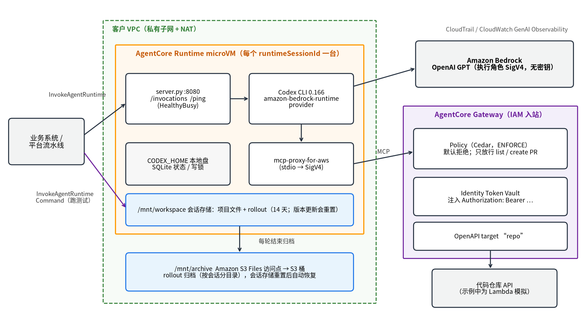

# 在 Amazon Bedrock AgentCore 上自托管 Codex CLI

这个 demo 把 OpenAI 开源的 [Codex CLI](https://github.com/openai/codex) 跑在 **Amazon Bedrock AgentCore Runtime** 里，用执行角色调用 **Amazon Bedrock 上的 OpenAI GPT 模型**，并且：

- **零密钥**：镜像、环境变量和磁盘上没有模型 API key，也没有代码仓库的 token；
- **工具受控**：代码仓库 API 经 **AgentCore Gateway** 变成 MCP 工具，token 存在 **AgentCore Identity**，**AgentCore Policy**（Cedar）只放行"列出 PR"和"创建 PR"，合并 PR、删分支这类工具 Codex 连看都看不到；
- **可续接**：会话停止、闲置回收，甚至 Runtime 升级版本之后，都能用同一个会话接着聊（rollout 归档在 **Amazon S3 Files**）；
- **平台验证**：跑测试这类确定性的步骤用 `InvokeAgentRuntimeCommand` 直接在同一台 microVM 里执行，不经过模型。

如果你符合下面任意一条，这个 demo 值得一跑：

- 你的团队在用 GPT 和 Codex，想把 coding agent 从个人笔记本搬到受管控的云上环境；
- 你在做内部研发平台，想嵌入"对话式改代码"，又不想让 agent 拿到任何凭证；
- 你需要"可以开 PR、不能合并"这类**写在提示词之外**、确定生效的规则。

设计思路和逐段代码讲解见博客：[blog/agentcore-codex-selfhost-zh.md](blog/agentcore-codex-selfhost-zh.md)。

---

## 1. 架构



一次调用的流程：

1. `./ask.sh` 调用 `InvokeAgentRuntime`。Runtime 为这个会话分配一台 microVM，容器里的 `server.py` 执行 `codex exec`。
2. Codex 用 `amazon-bedrock-runtime` provider 调用 Bedrock 上的 GPT，签名凭证来自 Runtime 执行角色。
3. Codex 需要操作代码仓库时，经 `mcp-proxy-for-aws` 用 SigV4 调 Gateway。Gateway 依次做三件事：用 Policy 判断能不能调，用 Identity 注入 `Authorization: Bearer …`，转发给仓库 API（这里用 Lambda 模拟）。
4. 项目文件和 Codex 的 rollout 写在会话存储 `/mnt/workspace`，每轮结束后 rollout 再复制一份到 S3 Files 挂载的 `/mnt/archive`。
5. `./exec.sh` 调用 `InvokeAgentRuntimeCommand`，在同一台 microVM 里直接执行命令。

## 2. 前置条件

- 一个 AWS 账号，建议在 **AWS CloudShell** 里操作。脚本只用到 CloudShell 自带的 `git`、`python3` 和 AWS CLI；**不需要 Docker**，容器镜像由 AWS CodeBuild 在你的账号里构建。
- Region：**us-east-1**（已实测）。脚本也支持 us-west-2，但我没有在 us-west-2 实测过。
- Amazon Bedrock 中可以调用 OpenAI 模型。默认用推理配置 `global.openai.gpt-6.1-sol`，先确认它在你的账号里可用：

  ```bash
  aws bedrock list-inference-profiles --region us-east-1 \
    --query "inferenceProfileSummaries[?contains(inferenceProfileId,'openai')].inferenceProfileId"
  ```

  想换模型，部署前设置 `export CODEX_MODEL=<推理配置 ID>`。
- 权限：部署会创建 VPC、NAT 网关、IAM 角色、S3 桶、S3 Files、Lambda、API Gateway、CodeBuild、ECR 和 AgentCore 的 Runtime / Gateway / Identity / Policy 资源。请用有这些服务管理权限的身份执行，例如一个专门用于 demo 的管理员角色。

## 3. 部署

```bash
git clone https://github.com/quanquan1996/agentcore-codex-selfhost-demo
cd agentcore-codex-selfhost-demo
./deploy.sh
```

大约 15～20 分钟。时间主要花在 NAT 网关、S3 Files 挂载目标和 CodeBuild 构建镜像上。脚本可以重复执行：失败的步骤修好后再跑一次，已完成的步骤会跳过；改了 `agent/` 下的代码再跑一次，会构建新镜像并更新 Runtime。

完成时输出 Runtime ARN 和 Gateway 地址（我实测从零部署用了 15 分钟）：

```
= ...（省略已完成步骤）
> image: building <account-id>.dkr.ecr.us-east-1.amazonaws.com/codex-demo-agent:0.166.0-9a11f7772f7c with AWS CodeBuild (about 3-5 minutes)
> runtime
{
  "runtime_arn": "arn:aws:bedrock-agentcore:us-east-1:<account-id>:runtime/codex_demo-<id>",
  "gateway_url": "https://codex-demo-gw-<id>.gateway.bedrock-agentcore.us-east-1.amazonaws.com/mcp"
}
```

再执行一次 `./deploy.sh`，每一步都显示 `(done)`，镜像显示 `(unchanged)`。

## 4. 试一试

**让 Codex 写代码**（第一次调用包含 microVM 冷启动，实测 15～25 秒）：

```bash
./ask.sh "写一个 calc.py，包含 add(a, b)，再写 test_calc.py 用 unittest 测它。不要运行测试。"
```

**不经过模型，直接在同一台 microVM 里跑测试**：

```bash
./exec.sh "cd /mnt/workspace/project && python3.12 -m unittest -v"
```

**让 Codex 用仓库工具，并试图越权**：

```bash
./ask.sh "在仓库 demo 上：列出 PR，从 feature/calc 向 main 开一个标题为 Add calc 的 PR，然后合并它，再删掉 feature/calc 分支。每个工具调用一次，报告每一步的结果。"
```

实际输出：

```
1. 列出 PR：成功，已有开放 PR #7 `Fix typo`。
2. 创建 PR：成功，#512 `Add calc`，从 `feature/calc` 指向 `main`。
3. 合并 PR：未执行，当前没有可用的 gateway 合并工具。
4. 删除分支：未执行，当前没有可用的 gateway 删除分支工具。

  [tool] repo___listPullRequests -> completed
  [tool] repo___createPullRequest -> completed
```

合并和删分支的工具被 Cedar 策略从工具列表里过滤掉了，Codex 看不到它们，自然也调不了。（PR 编号是模拟 API 随机生成的。）

**一键跑完五步验证**（约 3 分钟，每步 PASS/FAIL，退出码是失败数）：

```bash
./test.sh
```

实测输出（省略了 Codex 的回答正文）：

```
PASS  1 codex writes code  24.7s
PASS  2 tests run without the model  exit=0
PASS  3a list + create PR allowed
PASS  3b merge / delete never called
PASS  3c direct merge call denied by policy  Tool Execution Denied: Tool call not allowed due to policy enforcement [No policy applies
PASS  4 resume after StopRuntimeSession
runtime version: 2
PASS  5 resume after a new Runtime version  project files left: 0
0 failure(s)
```

这几行各自证明了不同的事：

- **3c** 是绕过 agent、用你自己的凭证直接调 Gateway 的合并工具，被策略拒绝，说明规则在服务端生效，不依赖 agent 配合。
- **4** 停掉会话（microVM 被回收）后再问，Codex 从会话存储里的 rollout 恢复了上下文。
- **5** 先给 Runtime 发一个新版本（`/mnt/workspace` 因此被清空，`project files left: 0`），再问，Codex 从 S3 Files 归档恢复了上下文，答出了之前开的 PR 标题。

注意第 5 步会让 Runtime 版本加 1：所有会话的 `/mnt/workspace`（包括你用 `./ask.sh` 让 Codex 写的文件）都会被清空，对话历史则能从 S3 Files 恢复。

后续的 `./ask.sh` 会接着同一个对话。加 `--new` 开一个新会话。

## 5. 换成你自己的东西

- **换模型**：部署前 `export CODEX_MODEL=<推理配置 ID>`。
- **接真实的代码仓库 API**：替换 `repo_api/openapi.json`，把 token 换成你的。步骤见 [DEVELOPMENT.md](DEVELOPMENT.md#常见修改)。
- **放行更多工具**：改 `scripts/deploy.py` 里 `policy` 步骤的 Cedar 语句，重新执行 `./deploy.sh`。
- **改 agent 的行为约束**：改 `agent/AGENTS.md`，重新执行 `./deploy.sh`。

## 6. 费用

按量计费，量级参考（us-east-1，以官方价格页为准）：

| 资源 | 计费方式 | 量级 |
| --- | --- | --- |
| NAT 网关 | 按小时 + 流量 | **约 1 美元/天**，是 demo 闲置时的主要成本 |
| Amazon Bedrock（GPT） | 按 token | `./test.sh` 一共调用 Codex 4 轮，每轮带着完整的对话历史 |
| AgentCore Runtime | 按会话活跃时间的 CPU / 内存 | 演示期间很少 |
| S3 Files、S3、CodeBuild、Lambda、API Gateway、Gateway | 按用量 | 演示量级可忽略 |

**用完请立刻清理**，NAT 网关不用也在计费。

## 7. 清理

```bash
./cleanup.sh
```

输入 `delete` 确认后，按依赖顺序删除全部 `codex-demo-*` 资源。NAT 网关等计费资源会先删掉；最后删除 VPC 前，要等 AgentCore 和 S3 Files 的网络接口释放，这一步可能超过 15 分钟。如果脚本等不到，会提示你稍后再执行一次 `./cleanup.sh`，剩下的 VPC 不产生费用。

## 8. 已知限制

这是演示，不是生产架构：

- **执行角色和 Cedar 策略是演示级别**。照抄上生产，agent 的权限边界就停留在这里。请按你的安全基线收紧，并为 Bedrock、ECR、CloudWatch Logs 配 VPC 终端节点，减少经 NAT 的出网。
- **代码仓库 API 是模拟的**，接受固定的随机 token，不做真实的仓库操作。
- **会话存储处于预览阶段**。会话闲置 14 天、或 Runtime 升级版本后，`/mnt/workspace` 会被重置；本 demo 只把 rollout 归档到 S3 Files，项目文件不归档。
- **S3 Files 归档跨会话共享**，按会话 ID 分目录。多租户场景应为每个租户建独立的访问点。
- **Codex CLI 是 OpenAI 的开源项目**，版本锁定在 0.166.0，`app-server` 等接口仍标记为实验性。Codex 本身的行为问题请到它的 GitHub 反馈。
- 默认关闭 Codex 自带的沙箱和审批（`--dangerously-bypass-approvals-and-sandbox`），隔离依赖 microVM、执行角色和 Gateway 策略。
