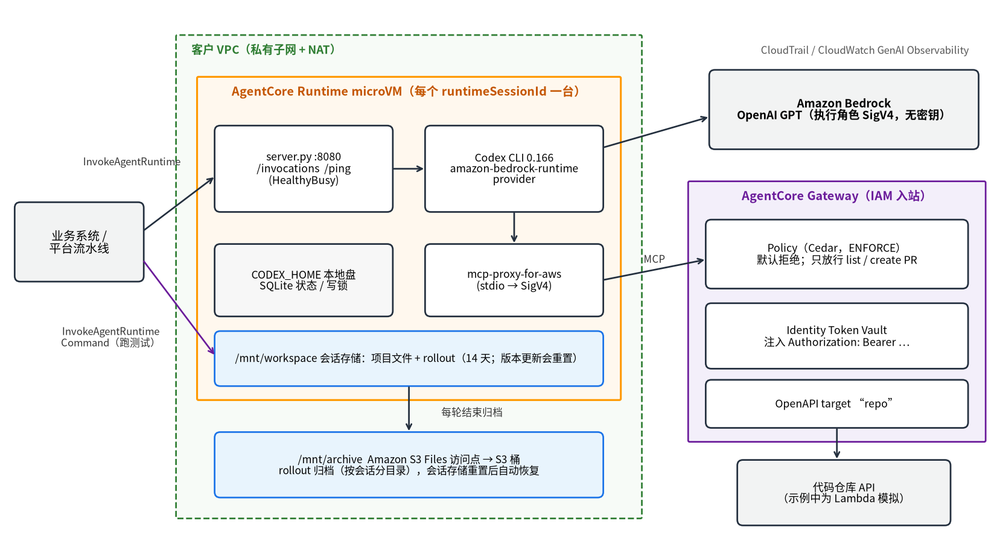

# 在 Amazon Bedrock AgentCore 上自托管 Codex CLI：零密钥、可续接、工具受控的 GPT 编码 Agent

> 摘要：本文介绍如何把 OpenAI 开源的 Codex CLI 部署到 Amazon Bedrock AgentCore Runtime，通过执行角色调用 Amazon Bedrock 上的 OpenAI GPT 模型；用会话存储和 Amazon S3 Files 实现跨 microVM、跨版本升级的会话续接；用 AgentCore Gateway、Identity 和 Policy 让 agent 只能以受控方式使用代码仓库等外部工具，且全程接触不到任何凭证。文中所有步骤均已在美国东部（弗吉尼亚北部）区域端到端实测。

## 一、背景

如果你想让 coding agent 离开个人笔记本，去做夜间批量修复代码扫描告警、按工单生成数据分析脚本，或者在内部研发平台里提供"对话式改代码"，很快会碰到下面四个问题：

1. **模型和工具链不想换**。你的团队已经熟悉 OpenAI GPT 模型和 Codex CLI 的行为（AGENTS.md、skills、MCP 配置），迁到云上之后希望一切照旧。
2. **密钥不能落地**。agent 的运行环境里不能出现长期有效的模型 API key，也不能出现 GitHub 等第三方系统的 token。
3. **agent 能做什么要可控**。agent 有 shell 权限，又可能被提示注入，"可以开 PR、不能合并 PR"这类规则不能只写在提示词里。
4. **长任务要能续接**。一次重构可能跑几十分钟，第二天你还想在同一个上下文里追问，平台升级之后历史也不能丢。

Amazon Bedrock 已经提供 OpenAI GPT 系列模型，并支持 OpenAI 兼容的 Responses API。Amazon Bedrock AgentCore 提供了解决上述问题所需的组件：Runtime 为每个会话提供一台独立的 microVM 和托管的会话存储；Gateway 把外部 API 变成 MCP 工具；Identity 托管第三方凭证；Policy 用 Cedar 语言对每一次工具调用做确定性的授权。本文把这些组件组合起来，搭建一个托管的 Codex 服务，并给出我在实际部署中踩到的坑。

## 二、方案选型

在亚马逊云科技上运行 Codex 风格的编码 agent，目前有三条路径：

| 维度 | AgentCore harness | Amazon Bedrock Managed Agents（with OpenAI） | 在 AgentCore Runtime 自托管 Codex CLI（本文） |
| --- | --- | --- | --- |
| Agent 主循环 | AgentCore 托管的通用 harness | 亚马逊云科技托管的 Codex harness | 你自己容器里的 Codex CLI |
| 你需要维护 | 配置（模型、提示词、工具） | Runtime 中的 exec-server | 整个 Codex CLI 镜像与版本 |
| 定制能力 | 中 | 中 | 高：可锁定版本，深度定制 AGENTS.md、skills、MCP、OTel |
| 适合 | 不想写代码，快速上线通用 agent | 想用 Codex harness 又希望少运维 | 需要控制 Codex 版本，或要把 Codex 嵌入自有产品 |

请根据团队的运维能力和定制需求选择。本文讨论第三条路径。

## 三、架构概览



【图 1：在 AgentCore 上自托管 Codex 的整体架构】

一次调用的处理流程如下：

1. 业务系统用 SigV4（或 OAuth/JWT）调用 `InvokeAgentRuntime`，带上 `runtimeSessionId`。AgentCore Runtime 为该会话分配一台 microVM，把请求转发给容器内的 `/invocations`。
2. 容器内的 `server.py` 调用 `codex exec`。Codex 使用 `amazon-bedrock-runtime` provider 调用 Amazon Bedrock 上的 GPT 模型，签名凭证来自 Runtime 的执行角色。
3. Codex 需要操作代码仓库时，通过 stdio 启动 `mcp-proxy-for-aws`，用执行角色对 AgentCore Gateway 发起 SigV4 签名的 MCP 请求。Gateway 先由 Policy 判断这次工具调用是否被允许，再由 Identity 从 Token Vault 取出仓库 token 注入请求头，最后转发给代码仓库 API。
4. 项目文件和 Codex 的会话记录（rollout）写在会话存储 `/mnt/workspace` 中；每轮结束后，rollout 再归档一份到 Amazon S3 Files 挂载的 `/mnt/archive`。
5. 跑测试、推送代码这类确定性的步骤，由平台通过 `InvokeAgentRuntimeCommand` 直接在同一台 microVM 里执行，不经过模型。

这个架构有四个关键属性：

- **零密钥**：镜像、环境变量和磁盘上都没有模型 API key 和仓库 token。模型调用由执行角色签名；仓库 token 只存在于 Identity 的 Token Vault 中。
- **工具受控**：Cedar 策略默认拒绝，只放行明确允许的工具；被拒绝的工具连工具列表里都看不到。
- **物理隔离**：每个会话一台 microVM，任务之间不共享文件系统、进程和网络端口。
- **可续接**：会话停止、闲置回收，甚至 Runtime 升级版本之后，都可以用同一个会话续接。

## 四、前提条件

- 一个已开通 Amazon Bedrock 上 OpenAI 模型访问权限的亚马逊云科技账号。本文使用美国东部（弗吉尼亚北部）区域和推理配置文件 `global.openai.gpt-6.1-sol`，请用 `aws bedrock list-inference-profiles` 确认所在区域可用的模型 ID。
- 一个可以使用 AWS CloudShell 的环境。部署脚本只依赖 CloudShell 自带的 `git`、`python3` 和 AWS CLI；容器镜像由 AWS CodeBuild 在你的账号里构建，本地不需要 Docker。
- 熟悉 Codex CLI、MCP 和 IAM 的基本概念。

本文用到的会话存储（session storage）目前处于预览阶段。配套代码用于演示，未经充分加固，照抄上生产会让 agent 的执行角色和工具策略停留在演示级别，请先按第七节和你的安全基线收紧。

完整代码见配套仓库 [agentcore-codex-selfhost-demo](https://github.com/quanquan1996/agentcore-codex-selfhost-demo)。在 CloudShell 里执行下面几行就能部署并跑完本文的全部验证，下文只展示关键片段：

```bash
git clone https://github.com/quanquan1996/agentcore-codex-selfhost-demo
cd agentcore-codex-selfhost-demo
./deploy.sh      # 约 15～20 分钟，主要时间花在 NAT 网关、S3 Files 挂载目标和镜像构建上
./test.sh        # 五步端到端验证，约 3 分钟，每步打印 PASS/FAIL
./cleanup.sh     # 删除全部资源
```

## 五、在 Runtime 中运行 Codex

### 5.1 HTTP 服务

AgentCore Runtime 的 HTTP 协议约定容器在 8080 端口提供 `POST /invocations` 和 `GET /ping` 两个接口。配套仓库中的 `server.py` 只依赖 Python 标准库，核心是调用 `codex exec` 并解析它的 JSONL 事件流：

```python
def run_codex(prompt, thread_id=None, session_id=None):
    cmd = ["codex", "exec"] + (["resume"] if thread_id else [])
    cmd += ["--json", "--skip-git-repo-check",
            "--dangerously-bypass-approvals-and-sandbox",
            "--model", MODEL,
            "-c", 'model_provider="amazon-bedrock-runtime"',
            "-c", f'model_providers.amazon-bedrock-runtime.aws.region="{REGION}"']
    if thread_id:
        restore_rollout(thread_id, session_id)   # 见第六节
        cmd += [thread_id]
    cmd += ["--", prompt]
    # 必须关闭 stdin，否则 codex exec 会一直等待输入
    proc = subprocess.run(cmd, cwd=os.path.join(WORKSPACE, "project"),
                          env=dict(os.environ, CODEX_HOME=CODEX_HOME),
                          stdin=subprocess.DEVNULL, capture_output=True, text=True, timeout=3600)
    result = {"thread_id": thread_id, "messages": [], "tool_calls": []}
    for line in proc.stdout.splitlines():
        try:
            ev = json.loads(line)
        except ValueError:
            continue
        item = ev.get("item", {})
        if ev["type"] == "thread.started":
            result["thread_id"] = ev["thread_id"]
        elif ev["type"] == "item.completed" and item.get("type") == "agent_message":
            result["messages"].append(item["text"])
        elif ev["type"] == "item.completed" and item.get("type") == "mcp_tool_call":
            result["tool_calls"].append({k: item.get(k) for k in ("server", "tool", "status")})
        elif ev["type"] == "turn.failed":
            result["error"] = ev["error"]["message"]
    archive_rollout(result["thread_id"], session_id)  # 见第六节
    return result
```

需要说明几个细节：

- **`thread.started` 事件**里的 `thread_id` 是续接会话要用的 ID；`turn.completed` 里有 token 用量；`turn.failed` 里有失败原因。一定要把 `turn.failed` 的信息返回给调用方，否则权限错误只会表现为"退出码 1、没有任何输出"。
- **`/ping` 返回 `HealthyBusy`**：Codex 运行期间返回 `HealthyBusy`，Runtime 就不会因空闲超时回收 microVM。`time_of_last_update` 只在状态真正变化时更新。如果每次都写入当前时间，空闲超时将永远不会触发，会话会一直存活到最长生命周期并占用配额。
- **`--dangerously-bypass-approvals-and-sandbox`**：关闭 Codex 自带的沙箱和审批，因为 microVM 本身就是隔离边界。agent 能做什么，由执行角色和第七节的 Gateway 策略决定。
- **同一个 `thread_id` 串行处理**：同一个 `runtimeSessionId` 的请求会路由到同一台 microVM。`server.py` 按 `thread_id` 加锁，避免两个请求同时续接同一个会话。

### 5.2 镜像与 Codex 配置

AgentCore Runtime 要求 ARM64 容器。镜像里除了 Codex CLI，还安装了 `mcp-proxy-for-aws`，用来把 Codex 的 stdio MCP 请求转换为对 Gateway 的 SigV4 签名请求：

```dockerfile
FROM --platform=linux/arm64 public.ecr.aws/amazonlinux/amazonlinux:2023
RUN dnf install -y git python3.12 python3.12-pip nodejs22 nodejs22-npm shadow-utils && dnf clean all
ARG CODEX_VERSION=0.166.0
RUN npm install -g @openai/codex@${CODEX_VERSION}
RUN python3.12 -m pip install --no-cache-dir mcp-proxy-for-aws==1.8.0
RUN useradd -m -u 1000 agent
COPY --chown=agent:agent config.toml AGENTS.md /home/agent/.codex/
COPY server.py gateway-mcp.sh /app/
USER agent
ENV CODEX_HOME=/home/agent/.codex WORKSPACE=/mnt/workspace ARCHIVE=/mnt/archive
EXPOSE 8080
CMD ["python3.12", "/app/server.py"]
```

`config.toml` 只放非敏感配置：

```toml
model = "global.openai.gpt-6.1-sol"
model_provider = "amazon-bedrock-runtime"
model_reasoning_effort = "low"
check_for_update_on_startup = false

[model_providers.amazon-bedrock-runtime.aws]
region = "us-east-1"

[otel]
log_user_prompt = false

[mcp_servers.gateway]
command = "/app/gateway-mcp.sh"
# Codex 以精简的环境变量启动 MCP 子进程，需要显式转发
env_vars = ["GATEWAY_URL", "AWS_REGION"]
startup_timeout_sec = 60
```

其中 `gateway-mcp.sh` 只有一行：`exec mcp-proxy-for-aws "$GATEWAY_URL" --service bedrock-agentcore --region "$AWS_REGION"`。Gateway 地址通过 Runtime 的环境变量传入。

镜像不需要你在本地构建。`deploy.sh` 把 `agent/` 目录打包上传到 Amazon S3，再由一个 ARM 架构的 AWS CodeBuild 项目执行 `docker build` 并推送到 Amazon ECR。镜像标签取自 `agent/` 目录内容的哈希值，所以你修改代码后重新执行 `deploy.sh`，脚本会构建新镜像并更新 Runtime；代码没变时则跳过构建。

`env_vars` 这一行很关键。Codex 启动 stdio MCP server 时只传递一个精简的环境变量集合，Runtime 注入的 `GATEWAY_URL` 和 `AWS_REGION` 不在其中。如果不显式转发，代理一启动就会退出，Codex 只会表现为"没有可用的 MCP 工具"。执行角色的临时凭证由 Runtime 的元数据端点提供，不依赖环境变量，所以不需要转发任何凭证。

### 5.3 执行角色

执行角色是 agent 能力的上限。除了 AgentCore Runtime 的基础权限（拉取 Amazon ECR 镜像、写 Amazon CloudWatch Logs、上报 X-Ray 追踪和指标），还需要以下几组权限：

```json
[
  {"Effect": "Allow",
   "Action": ["bedrock:InvokeModel", "bedrock:InvokeModelWithResponseStream"],
   "Resource": ["arn:aws:bedrock:*::foundation-model/openai.*",
                "arn:aws:bedrock:<region>:<account-id>:inference-profile/*.openai.*"]},
  {"Effect": "Allow", "Action": "bedrock:InvokeModel",
   "Resource": "arn:aws:bedrock:<region>:<account-id>:project/default"},
  {"Effect": "Allow", "Action": "bedrock-agentcore:InvokeGateway",
   "Resource": "<gateway-arn>"},
  {"Effect": "Allow", "Action": ["s3files:ClientMount", "s3files:ClientWrite"],
   "Resource": "<file-system-arn>",
   "Condition": {"ArnEquals": {"s3files:AccessPointArn": "<access-point-arn>"}}},
  {"Effect": "Allow", "Action": ["s3files:GetAccessPoint", "s3files:ListMountTargets"],
   "Resource": ["<file-system-arn>", "<access-point-arn>"]}
]
```

有两点容易遗漏：

- **`project/default`**：Bedrock 的 OpenAI 兼容端点（`/openai/v1/responses`）除了校验模型和推理配置文件，还会对默认 project 资源 `arn:aws:bedrock:<region>:<account-id>:project/default` 校验 `bedrock:InvokeModel`。缺少这一条时，Codex 会收到 401，并在重试 5 次后失败。
- **S3 Files 的校验权限**：`CreateAgentRuntime` 在创建时会以执行角色校验 `s3files:GetAccessPoint` 和 `s3files:ListMountTargets`，而且校验时不带访问点条件键。如果把 `GetAccessPoint` 和带条件的挂载权限写在同一条语句里，创建会失败。

Runtime 显示 READY 并不代表模型一定能调通：服务控制策略（SCP）或模型访问设置仍可能拒绝请求。部署完成后，请实际执行一次调用来验证。

### 5.4 创建 Runtime

```python
control = boto3.client("bedrock-agentcore-control", region_name="us-east-1")
rt = control.create_agent_runtime(
    agentRuntimeName="codex_sample",
    roleArn=EXEC_ROLE_ARN,
    agentRuntimeArtifact={"containerConfiguration": {"containerUri": IMAGE_URI}},
    networkConfiguration={"networkMode": "VPC", "networkModeConfig": {
        "subnets": PRIVATE_SUBNETS, "securityGroups": [RUNTIME_SG]}},
    filesystemConfigurations=[
        {"sessionStorage": {"mountPath": "/mnt/workspace"}},
        {"s3FilesAccessPoint": {"accessPointArn": ACCESS_POINT_ARN, "mountPath": "/mnt/archive"}}],
    environmentVariables={"GATEWAY_URL": GATEWAY_URL, "CODEX_MODEL": "global.openai.gpt-6.1-sol"},
    lifecycleConfiguration={"idleRuntimeSessionTimeout": 900, "maxLifetime": 28800},
)
```

网络方面有三点要求：

- 挂载 S3 Files 必须使用 VPC 网络模式。
- 子网必须位于 AgentCore 支持的可用区（例如 us-east-1 的 `use1-az1`、`use1-az2`、`use1-az4`），并且与 S3 Files 挂载目标所在的可用区重叠。
- Runtime 的弹性网络接口只有私有 IP，需要放在通过 NAT 网关出网的私有子网中；放在公有子网并不能出网。

安全组方面，挂载目标的安全组需要允许来自 Runtime 安全组的 TCP 2049 入站。生产环境建议为 Amazon Bedrock、ECR、CloudWatch Logs 等服务配置 VPC 终端节点，减少经 NAT 的出网流量。

后续用 `UpdateAgentRuntime` 更新镜像时要注意：`GetAgentRuntime` 返回的网络配置里带有 `requireServiceS3Endpoint` 字段，这个字段在创建后不可修改，原样传回会被拒绝，需要先删除。

## 六、会话持久化：三层存储

Codex 的状态目录 `CODEX_HOME` 里有两类数据：

| 数据 | 位置 | 作用 | 本文的存放位置 |
| --- | --- | --- | --- |
| 会话记录（rollout） | `sessions/YYYY/MM/DD/rollout-*.jsonl` | 一个会话完整的对话和工具调用记录，续接时据此重建上下文 | 会话存储，并归档到 S3 Files |
| 状态库 | `state_*.sqlite`、`logs_*.sqlite` 等 WAL 模式数据库 | 索引、日志和本地缓存 | microVM 本地盘 |
| 线程写锁 | `thread-writer-locks/` | 防止同一会话被并发写入 | microVM 本地盘 |

我在 Codex CLI 0.166 上验证过：准备一个全新的 `CODEX_HOME`（没有任何 SQLite 文件），只放入原会话的 rollout 文件，执行 `codex exec resume <thread_id>`，Codex 能正确恢复上下文。也就是说，**续接只依赖 rollout 文件**。

因此 `server.py` 启动时，把 `CODEX_HOME` 放在本地盘，只把其中的 `sessions` 目录用符号链接指向会话存储：

```python
def prepare_dirs():
    os.makedirs(os.path.join(WORKSPACE, "project"), exist_ok=True)
    os.makedirs(SESSIONS, exist_ok=True)          # /mnt/workspace/.codex-sessions
    os.makedirs(CODEX_HOME, exist_ok=True)
    link = os.path.join(CODEX_HOME, "sessions")
    if not os.path.islink(link):
        os.symlink(SESSIONS, link)
```

这样做的原因是：SQLite 的 WAL 模式依赖文件锁和共享内存，而会话存储的文件锁不会跨 stop/resume 保留，不适合存放数据库和锁文件。需要持久化的只有 rollout 文件，它体积小、只追加写入。

会话存储有两个边界：会话**闲置 14 天**后数据会被删除；**Runtime 版本更新**后，再次调用会拿到一个全新的空文件系统。对于平台型产品，升级镜像是常态，所以本文又加了第三层：每轮结束后，把 rollout 复制到 S3 Files 挂载的 `/mnt/archive/rollouts/<runtimeSessionId>/`；续接时如果本地找不到 rollout，就从归档恢复。

```python
def restore_rollout(thread_id, session_id):
    if glob.glob(os.path.join(SESSIONS, "**", f"*{thread_id}.jsonl"), recursive=True):
        return "local"
    adir = os.path.join(ARCHIVE, "rollouts", session_id)
    for src in glob.glob(os.path.join(adir, "**", f"*{thread_id}.jsonl"), recursive=True):
        dst = os.path.join(SESSIONS, os.path.relpath(src, adir))
        os.makedirs(os.path.dirname(dst), exist_ok=True)
        shutil.copy2(src, dst)
        return "archive"
    return "missing"
```

会话 ID 从请求头 `X-Amzn-Bedrock-AgentCore-Runtime-Session-Id` 获取。S3 Files 是跨会话共享的，`server.py` 按会话 ID 分目录存放；多租户场景下，建议为每个租户使用独立的访问点（以不同的根目录和 POSIX 身份隔离）。同一个 S3 Files 文件系统也可以挂载团队共享的 skills 和 AGENTS.md，改一次，所有会话在下一次调用时就能看到。

## 七、工具与凭证：Gateway、Identity 与 Policy

关闭 Codex 自带沙箱之后，"agent 能对外部系统做什么"不能只依赖提示词。本文把代码仓库 API 通过 AgentCore Gateway 暴露为 MCP 工具，并叠加了两层控制。

### 7.1 凭证不进 microVM：Identity

配套仓库用 Amazon API Gateway 和 AWS Lambda 模拟了一个代码仓库 API（列出 PR、创建 PR、合并 PR、删除分支），它要求请求头携带 `Authorization: Bearer <token>`。部署时把这个 token 存入 AgentCore Identity：

```python
r = control.create_api_key_credential_provider(name="codex-sample-repo-token", apiKey=REPO_TOKEN)
```

然后创建 IAM 入站认证的 Gateway，并添加一个 OpenAPI 类型的 target，凭证来源指向这个 provider：

```python
control.create_gateway_target(
    gatewayIdentifier=GATEWAY_ID, name="repo",
    targetConfiguration={"mcp": {"openApiSchema": {"inlinePayload": OPENAPI_SPEC}}},
    credentialProviderConfigurations=[{
        "credentialProviderType": "API_KEY",
        "credentialProvider": {"apiKeyCredentialProvider": {
            "providerArn": PROVIDER_ARN,
            "credentialParameterName": "Authorization",
            "credentialPrefix": "Bearer",
            "credentialLocation": "HEADER"}}}])
```

Gateway 的服务角色需要 `bedrock-agentcore:GetWorkloadAccessToken`、`bedrock-agentcore:GetResourceApiKey`，以及读取该 provider 对应 Secrets Manager 密钥的权限。OpenAPI 中的每个 `operationId` 会成为一个 MCP 工具，名称为 `<target 名>___<operationId>`，例如 `repo___createPullRequest`。

Codex 侧看到的只是一个 MCP 工具。token 只存在于 Token Vault 中，由 Gateway 在出站时注入，不出现在镜像、环境变量、磁盘或模型上下文中。换成真实的 GitHub 时，只需把 OpenAPI 描述和 token 换掉。

### 7.2 每次工具调用都要过策略：Policy

接下来创建一个策略引擎，写一条 Cedar 策略，只允许列出和创建 PR：

```text
permit (
    principal,
    action in [AgentCore::Action::"repo___listPullRequests",
               AgentCore::Action::"repo___createPullRequest"],
    resource == AgentCore::Gateway::"<gateway-arn>"
);
```

然后以 `ENFORCE` 模式把策略引擎关联到 Gateway：

```python
control.update_gateway(gatewayIdentifier=GATEWAY_ID, name=GW_NAME, roleArn=GW_ROLE_ARN,
                       protocolType="MCP", authorizerType="AWS_IAM",
                       policyEngineConfiguration={"arn": POLICY_ENGINE_ARN, "mode": "ENFORCE"})
```

关联之前，Gateway 的服务角色必须先具备 `bedrock-agentcore:GetPolicyEngine`、`bedrock-agentcore:AuthorizeAction` 和 `bedrock-agentcore:PartiallyAuthorizeActions` 权限，否则 `UpdateGateway` 会直接报错。

实测中，这条策略在两个层面生效：

- **工具列表被过滤**。`tools/list` 只返回 `repo___listPullRequests` 和 `repo___createPullRequest`。Codex 被要求"合并 PR、删除分支"时，回答的是"没有可用的合并工具"，根本不会发起调用。
- **直接调用被拒绝**。绕过 agent，直接对 Gateway 发起 `tools/call` 调用 `repo___mergePullRequest`，返回的是 `-32002 Tool Execution Denied: ... No policy applies to the request (denied by default)`。

后端 Lambda 的日志中只出现过 `GET /repos/demo/pulls` 和 `POST /repos/demo/pulls`，被拒绝的调用没有到达后端。

Cedar 还支持基于工具参数的条件，例如只允许向某个仓库或分支开 PR。策略存放在 Gateway 一侧，修改时不需要改动 agent 代码，也不需要重新部署镜像。

## 八、让平台而不是模型来验证结果

"测试是否通过""代码是否推送成功"这类问题，不应该由模型来回答。AgentCore Runtime 的 `InvokeAgentRuntimeCommand` 可以在同一个会话的 microVM 里直接执行命令，并流式返回标准输出和退出码：

```python
r = client.invoke_agent_runtime_command(
    agentRuntimeArn=RUNTIME_ARN, runtimeSessionId=session_id,
    body={"command": "/bin/sh -c 'cd /mnt/workspace/project && python3.12 -m unittest -v'",
          "timeout": 120})
for ev in r["stream"]:
    chunk = ev.get("chunk", {})
    if "contentDelta" in chunk:
        print(chunk["contentDelta"].get("stdout", ""), end="")
    if "contentStop" in chunk:
        exit_code = chunk["contentStop"]["exitCode"]
```

命令不经过 shell 解析，直接执行。如果用到 `cd`、`&&` 或管道，需要像上面一样用 `/bin/sh -c` 包一层。

这样就形成了一个闭环：Codex 负责写代码，平台负责跑测试并根据退出码决定下一步（例如把失败日志交回 Codex 修复，或者调用创建 PR 的工具）。这一步不消耗 token，结果也是确定的。

## 九、可观测性与评估

- **审计**：每次 `InvokeAgentRuntime`、Gateway 工具调用和模型调用都记录在 AWS CloudTrail 中。
- **运行指标**：Runtime 的会话数、延迟和错误可以在 CloudWatch GenAI Observability 中查看。Codex 自身支持 OpenTelemetry 导出，设置 `log_user_prompt = false` 可以避免提示词进入日志。
- **质量评估**：AgentCore Evaluations 的在线评估可以对 Runtime 中的真实会话抽样打分，用来比较不同模型（例如两个 GPT 版本）或不同 AGENTS.md 版本在同类任务上的表现。

## 十、实测结果

我用配套仓库中的 `./test.sh` 在 us-east-1 从零部署后跑了完整流程，结果如下：

| 步骤 | 操作 | 结果 |
| --- | --- | --- |
| 1 | Codex 编写 `calc.py` 和单元测试 | 成功，15～25 秒（含 microVM 冷启动，多次实测） |
| 2 | `InvokeAgentRuntimeCommand` 运行单元测试 | 5 个测试通过，退出码 0，不经过模型 |
| 3 | Codex 通过 Gateway 列出并创建 PR，并尝试合并和删分支 | 列出、创建成功；合并、删分支的工具不可见，未发起调用 |
| 3' | 绕过 agent 直接调用合并 PR 工具 | 返回 `-32002`，默认拒绝 |
| 4 | `StopRuntimeSession` 后用同一会话续接 | 从会话存储恢复，正确回忆之前创建的文件 |
| 5 | 更新 Runtime 版本后续接 | `/mnt/workspace` 已被清空，rollout 从 S3 Files 恢复，正确回忆 PR 标题 |

## 十一、踩坑清单

下面是我从零部署这套方案时实际遇到的问题。前三条不报错或报错信息不直观，最容易浪费排查时间：

| 现象 | 原因 | 解决方法 |
| --- | --- | --- |
| `codex exec` 在容器里一直挂起 | stdin 未关闭，Codex 在等待输入 | 子进程使用 `stdin=DEVNULL` |
| Codex 返回 401，重试 5 次后失败 | OpenAI 兼容端点会校验 `project/default` | 执行角色增加对 `project/default` 的 `bedrock:InvokeModel` |
| Codex 提示没有可用的 MCP 工具 | MCP 子进程拿不到 Runtime 注入的环境变量 | `config.toml` 中用 `env_vars` 显式转发 |
| `CreateAgentRuntime` 提示缺少 S3 Files 权限 | 创建时以无条件键的方式校验 `GetAccessPoint`、`ListMountTargets` | 把这两个动作单独写成一条不带条件的语句 |
| `UpdateGateway` 关联策略引擎失败 | Gateway 角色缺少策略引擎权限 | 增加 `GetPolicyEngine`、`AuthorizeAction`、`PartiallyAuthorizeActions` |
| `UpdateAgentRuntime` 报 `requireServiceS3Endpoint` 不可修改 | 原样回传了 `GetAgentRuntime` 的网络配置 | 更新前删除该字段 |
| `InvokeAgentRuntimeCommand` 报 `cd: too many arguments` | 命令不经过 shell 解析 | 用 `/bin/sh -c '...'` 包装 |

## 十二、清理资源

配套仓库会创建 VPC、NAT 网关、S3 Files 文件系统、Lambda、API Gateway、CodeBuild 项目、AgentCore 各项资源和 IAM 角色，其中 NAT 网关按小时计费。测试完成后，请执行 `./cleanup.sh` 删除全部资源。脚本会按依赖顺序删除，先删 NAT 网关等计费资源。AgentCore 和 S3 Files 的网络接口在资源删除后才异步释放，实测超过 15 分钟，所以 VPC 可能要再执行一次 `./cleanup.sh` 才能删掉。

## 十三、总结

本文演示了在 Amazon Bedrock AgentCore 上自托管 Codex CLI 的完整方案：

- 用 `amazon-bedrock-runtime` provider 和执行角色调用 Amazon Bedrock 上的 OpenAI GPT 模型，运行环境中不存放任何模型密钥；
- 只持久化 Codex 的 rollout 文件，用"本地盘 + 会话存储 + S3 Files 归档"三层存储，实现跨 microVM、跨版本升级的会话续接；
- 用 AgentCore Gateway 把外部 API 变成 MCP 工具，用 Identity 托管第三方凭证，用 Policy 以 Cedar 策略默认拒绝、按需放行；
- 用 `InvokeAgentRuntimeCommand` 让平台而不是模型去执行和判定确定性的步骤。

对于希望继续使用 GPT 模型和 Codex 工具链、同时满足企业安全与审计要求的团队，这是一个可以快速验证的起点。

## 参考资料

- [It's safe to close your laptop now: Hosting coding agents on Amazon Bedrock AgentCore](https://aws.amazon.com/blogs/machine-learning/its-safe-to-close-your-laptop-now-hosting-coding-agents-on-amazon-bedrock-agentcore/)
- [AgentCore Runtime HTTP 协议约定](https://docs.aws.amazon.com/bedrock-agentcore/latest/devguide/runtime-http-protocol-contract.html)
- [AgentCore Runtime 文件系统配置](https://docs.aws.amazon.com/bedrock-agentcore/latest/devguide/runtime-filesystem-configurations.html)
- [在 AgentCore Runtime 会话中执行命令](https://docs.aws.amazon.com/bedrock-agentcore/latest/devguide/runtime-execute-command.html)
- [AgentCore Gateway 出站认证](https://docs.aws.amazon.com/bedrock-agentcore/latest/devguide/gateway-outbound-auth.html)
- [Policy in AgentCore 权限配置](https://docs.aws.amazon.com/bedrock-agentcore/latest/devguide/policy-permissions.html)
- [AgentCore VPC 配置](https://docs.aws.amazon.com/bedrock-agentcore/latest/devguide/agentcore-vpc.html)
- [Amazon S3 Files 先决条件](https://docs.aws.amazon.com/AmazonS3/latest/userguide/s3-files-prereq-policies.html)
- [aws-samples/sample-amazon-bedrock-agentcore-coding-agents](https://github.com/aws-samples/sample-amazon-bedrock-agentcore-coding-agents)
- [OpenAI Codex CLI](https://github.com/openai/codex)

## 作者简介

（请填写：姓名，亚马逊云科技解决方案架构师，负责……，专注于生成式 AI 与 Agent 方向。）
